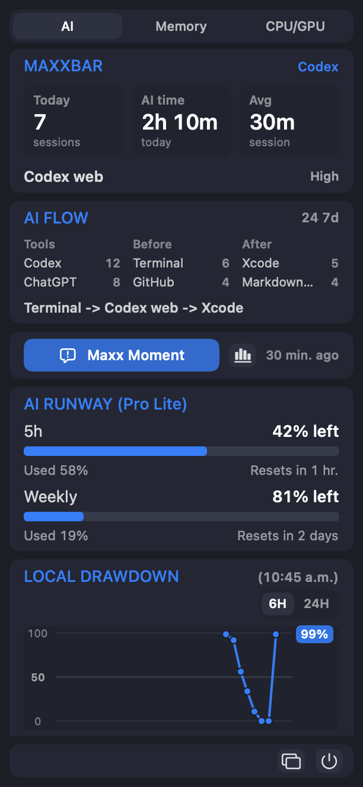

# MaxxBar

A macOS menu bar companion for AI runway, AI session patterns, and machine load. MaxxBar keeps the useful Codex quota, token, memory, and CPU/GPU foundations from Menu Bar Stats, then adds local AI usage context: what AI tool is active, how often AI sessions happen, what apps/sites come before and after, and when you capture a Maxx Moment because AI was wrong.

## Screenshots

### AI Usage



The AI panel shows live Codex 5H and weekly limits, local token estimates,
persisted drawdown, AI session summaries, before/after app context, and a
one-click Maxx Moment capture for times when AI was wrong.

### Memory


### CPU/GPU


## Current Features

- Two-line menu bar status for AI runway and memory pressure.
- AI usage panel with Codex limits, persistent local quota history, drawdown milestones, cache-token detail, token/session totals, top token users, and context actions for local Codex sessions.
- Local AI activity logging for app/site metadata, AI surface detection, session duration estimates, before/after workflow paths, and nearby system-load context.
- Maxx Moment capture for saving the current local context when AI was wrong.
- Local HTML AI insights report with top tools, likely use cases, before/after apps, workflow paths, and a Sankey-style path visual.
- Memory popover with pressure, memory breakdown, top processes, paging, swap, history, and lighter-weight numeric values for scanability.
- Grouped and raw process memory views with app icons.
- CPU/GPU panel with user/system history, per-core efficiency/performance load rings, grouped CPU processes, thermal summary, detailed temperatures, and uptime.
- Pop-out window mode with resize support and quit control.

## Known Limits

Some low-level hardware data requires privileged or private telemetry that this app does not currently collect directly:

- CPU/GPU die temperatures.
- Fan RPM and fan controller state.
- GPU usage, GPU memory, FPS, and GPU frequency.
- SSD, Wi-Fi, palm-rest, airflow, and other detailed thermal sensors.
- Per-process network attribution.

The app marks unavailable values clearly rather than inventing data. A native helper target is included for privileged sensor collection work.

## Build

```sh
swift build
```

## Build The App Bundle

```sh
Scripts/build-app.sh
```

The app bundle is written to `Dist/MaxxBar.app`. The renderer used for the
README screenshots can write any panel to a PNG:

```sh
.build/debug/MaxxBar --render-popover Artifacts/screenshot-llm.png llm
.build/debug/MaxxBar --render-popover Artifacts/screenshot-memory.png memory
.build/debug/MaxxBar --render-popover Artifacts/screenshot-cpugpu.png cpugpu
```

## Install On This Mac

```sh
Scripts/install-app.sh
```

The install script builds a fresh local app bundle, copies it to
`~/Applications/MaxxBar.app`, signs it ad hoc, and recreates the Desktop
shortcut so it points at the local install instead of an iCloud-hosted build
artifact from another laptop.

## Sensor Helper

Build and install the privileged helper:

```sh
Scripts/install-sensor-helper.sh
```

The helper runs as `com.hector.MaxxBarSensorHelper` and writes a local snapshot to:

```text
/Library/Application Support/MaxxBar/sensors.json
```

Remove it with:

```sh
Scripts/uninstall-sensor-helper.sh
```

## Useful Verification Commands

```sh
swift run MaxxBar -- --sample
swift run MaxxBar -- --render-popover Artifacts/maxxbar-ai-popover.png ai
swift run MaxxBar -- --write-ai-report
Dist/MaxxBar.app/Contents/MacOS/MaxxBar --verify-popover-action
Dist/MaxxBar.app/Contents/MacOS/MaxxBar --verify-popout-action
```

## Data Notes

See `Docs/data-audit.md` for implementation notes about source paths, validation, and remaining telemetry gaps.

LLM quota history is stored in:

```text
~/Library/Application Support/MaxxBar/llm-quota-history.json
```

AI activity metadata is stored locally in:

```text
~/Library/Application Support/MaxxBar/ai-activity.jsonl
~/Library/Application Support/MaxxBar/maxx-moments.jsonl
~/Library/Application Support/MaxxBar/ai-usage-insights.html
```

The AI logs are local-only metadata. They do not store screenshots, OCR output,
full typed content, or cloud uploads.

Each sample records the sampled time, 5H remaining percentage, weekly remaining
percentage, and current plan type when the Codex usage API reports one. The LLM
panel derives the most recent drawdown timeline from these samples, including
the last full point, threshold crossings, exhaustion, reset, elapsed time, and
the plan logged for that run. Exact crossing times are bounded by the sampling
interval.
