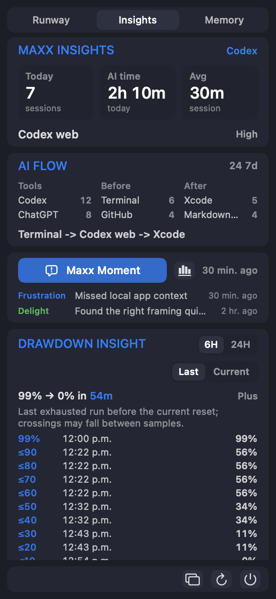
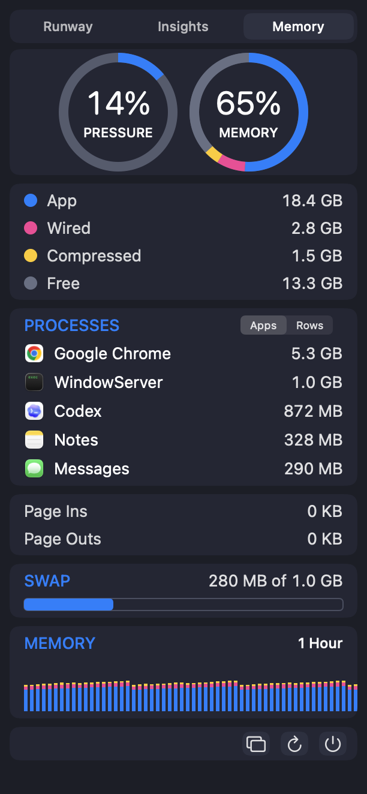

# MaxxBar

MaxxBar is a macOS menu bar companion for Codex and Claude runway, local AI usage insight, and machine context. It brings quota, token, memory, and workflow signals into one quiet daily surface, then points the product at a sharper question: how much AI runway is left, what local sessions are driving it, and where AI output is moving in your work.

Current release: `v0.2.0`. See [RELEASE_NOTES.md](RELEASE_NOTES.md) for the ongoing release history.

## Screenshots

<p>
  
  
  
</p>

## What It Does

- Shows separate Claude and Codex menu bar columns with 5h / weekly percent remaining. A `~` marks a previously checked reading.
- Opens a Runway-first popover with live Codex and Claude limits when authenticated, reset credits, local quota history, drawdown insight, cache-token detail, combined token/session totals, and recent session timelines.
- Provides an Insights tab with detected provider accounts/plans, today’s time and session share, a seven-day model mix and token distribution, output destinations, copy/paste flow metadata, before/after workflow paths, and recent Codex and Claude session context.
- Generates a separate MaxxBar Hub with Tracework-aligned navigation for Overview, AI Insights, Runway, and Sessions.
- Provides a Clipboard workspace with a live current-item marker, seven-day event queue, temporary local image previews, content-type metadata, and Claude/Codex inbound/outbound debugging insights.
- Keeps Memory visible with pressure, memory breakdown, top processes, swap, and a compact CPU/GPU temperature and fan RPM card beneath Swap.
- Includes deeper CPU/GPU, sensor, and network panels for advanced/debug builds.
- Installs a local app bundle and recreates the Desktop shortcut so the launcher points at the latest local build.

## Popover Tabs

- Runway: live Codex and Claude limits, resets, local drawdown, and a combined session timeline.
- Insights: models used, token-share distribution, AI usage patterns, output destinations, and AI workflow paths.
- Clipboard: Queue distinguishes the current clipboard item from history; Insights summarizes known/unknown sources and destinations for Claude and Codex.
- Memory: pressure, memory mix, top apps/processes, and swap.

Drag the lower-right grip to resize the popover; MaxxBar stores the last width and height locally and restores them at the next open or launch. The bottom action bar opens the MaxxBar Hub, starts Deep Trace in Tracework when available, opens the popover as a window, relaunches the app, or quits. Dense chart/help titles use a short hover delay and can be clicked to pin the explanation; bottom action icons and the compact version label show immediate labels.

## Build

```sh
swift build
```

## Build The App Bundle

```sh
Scripts/build-app.sh
```

The app bundle is written to `Dist.noindex/MaxxBar.app` by default. Set `APP_VERSION` or `BUILD_VERSION` to override bundle metadata:

```sh
APP_VERSION=0.2.0 BUILD_VERSION=0710.1200 Scripts/build-app.sh
```

## Install On This Mac

```sh
Scripts/install-app.sh
```

The install script builds a fresh local app bundle, copies it to `~/Applications/MaxxBar.app`, signs it ad hoc, and recreates the Desktop shortcut so it points at the local install instead of an iCloud-hosted build artifact from another laptop.

## Useful Verification Commands

```sh
swift run MaxxBar -- --sample
swift run MaxxBar -- --render-popover Artifacts/screenshot-llm.png runway
swift run MaxxBar -- --render-popover Artifacts/screenshot-insights.png insights
swift run MaxxBar -- --render-popover Artifacts/screenshot-clipboard.png clipboard
swift run MaxxBar -- --render-popover Artifacts/screenshot-memory.png memory
swift run MaxxBar -- --write-ai-report
Dist.noindex/MaxxBar.app/Contents/MacOS/MaxxBar --verify-popover-action
Dist.noindex/MaxxBar.app/Contents/MacOS/MaxxBar --verify-popout-action
```

## Data And Privacy

See `Docs/data-audit.md` for implementation notes about source paths, validation, and remaining telemetry gaps.

### Codex Authentication And Live Usage

To show live Codex quota and reset information, MaxxBar reads the existing Codex access token from `~/.codex/auth.json` and sends it as a bearer token only to `https://chatgpt.com/backend-api/wham/usage`. MaxxBar does not copy the token into its own data files, include it in reports, or send it to any other service.

This ChatGPT usage endpoint is undocumented and is not a stable, officially supported public API. It may change or stop working without notice. MaxxBar is an independent project and is not affiliated with or endorsed by OpenAI. Users should install and run MaxxBar only if they are comfortable allowing a local application to read their existing Codex credential for this request. If the credential or endpoint is unavailable, live quota information is disabled while locally derived session and token information may remain available.

### Claude Sessions And Live Usage

MaxxBar discovers local Claude Code and Claude Desktop/Cowork transcripts under `~/.claude/projects` and Claude's local-agent session directory. It reads session metadata and the token-usage fields Claude already stores locally: provider, title, project, model, timestamps, input, cache creation/read, and output totals. Prompt previews are limited to the locally stored first user message; MaxxBar does not upload transcript content.

The Insights account label comes from Claude’s local `~/.claude.json` profile metadata (email, display name, organization, and seat tier). Codex account email and plan come from the live usage response described above. These labels remain inside MaxxBar’s local UI and reports.

For live five-hour and weekly Claude runway, MaxxBar uses the existing Claude Code OAuth credential from `~/.claude/.credentials.json` or the `Claude Code-credentials` macOS Keychain item and sends it only to `https://api.anthropic.com/api/oauth/usage`. The token is not copied into MaxxBar data or reports. This endpoint is used by Claude Code but is not a stable public API. Claude Desktop/Cowork authentication alone may not expose a Claude Code OAuth credential; in that state MaxxBar still captures local Claude sessions and shows a provider-status note until Claude Code is signed in.

Claude Code keep-alive: when Claude Code's stored access token has expired (or Claude rejects it), MaxxBar runs one tiny `claude -p "ok" --model haiku` request from an empty temporary folder, with no tools, MCP servers, slash commands, settings or saved session, and a 60-second limit. Claude Code refreshes and saves its own sign-in as part of that request; MaxxBar never writes the Keychain and never runs `claude auth login`. MaxxBar then checks that the Keychain holds a complete credential with a later expiry and reads usage right away. A failed attempt is retried once after 10 minutes; after that the card says to open `claude` or run `claude auth login`, and nothing runs again until the credential changes. Cost: one Haiku request roughly every 8 hours. Turn it off with `defaults write com.hector.MaxxBar ClaudeKeepAlive -bool false`. Each attempt is logged (times, exit code, expiry times; never tokens or CLI output) to `~/Library/Application Support/MaxxBar/claude-keepalive.log`. Without a usable token, MaxxBar keeps showing the last usage it read, marked with its check time, until those windows reset.

For live Claude runway without extra network requests, run `Scripts/install-claude-statusline-tap.sh` once. It points Claude Code's status line at a small tap that saves the `rate_limits` Claude Code already receives (5h and weekly usage) to `~/Library/Application Support/MaxxBar/claude-statusline.json`, then runs your previous status line command so its output is unchanged. MaxxBar prefers a capture from the last 30 minutes; while one exists it asks the usage endpoint at most hourly, only for the Opus and Sonnet weekly windows. Undo with `Scripts/install-claude-statusline-tap.sh --uninstall`.

Otherwise, Claude usage refreshes from the endpoint at most every fifteen minutes. HTTP 429 responses trigger an increasing cooldown (five minutes to one hour), honoring longer `Retry-After` delays. The last successful usage response and cooldown are saved locally across restarts, with the Claude account ID (or a credential fingerprint) but no OAuth token. The cooldown survives Claude Code's token refreshes. Cached readings show their check time; windows whose reset has passed are omitted, and readings older than 24 hours are discarded.

Local files are stored under:

```text
~/Library/Application Support/MaxxBar/claude-auth-retry.json
~/Library/Application Support/MaxxBar/claude-usage-cache.json
~/Library/Application Support/MaxxBar/llm-quota-history.json
~/Library/Application Support/MaxxBar/ai-activity.jsonl
~/Library/Application Support/MaxxBar/ai-transfers.jsonl
~/Library/Application Support/MaxxBar/clipboard-metadata.jsonl
~/Library/Application Support/MaxxBar/clipboard-images/
~/Library/Application Support/MaxxBar/maxxbar-hub.html
```

The AI and clipboard logs are local-only metadata. MaxxBar watches the macOS pasteboard change counter, item count, and declared type identifiers, so clipboard writes made through keyboard shortcuts, menus, Copy buttons, and screenshot-to-clipboard can enter the Queue. When a write contains an image, MaxxBar saves a full-size local PNG plus a small thumbnail for up to 24 hours, capped at 100 images and 250 MB; clicking the thumbnail opens the saved PNG. It does not store text or other non-image clipboard payloads. On launch, it records an origin-unknown metadata baseline so “Current clipboard” remains distinct from historical writes.

Paste attempts currently mean observed Cmd+V. macOS does not provide a general notification when another app reads the pasteboard, so right-click and menu-driven pastes cannot always be counted or attributed. A displayed output flow requires an observed clipboard write followed by a paste within 15 minutes; Claude-to-Claude and Codex-to-Codex pairs are excluded while Claude↔Codex and AI-to-other-app flows remain. MaxxBar does not store text clipboard contents, OCR output, typed text, or cloud uploads; temporary copied-image files remain local.

## Known Limits

CPU/GPU temperatures and fan RPM are read locally through a read-only AppleSMC connection when available, with the existing native-helper cache and public battery telemetry as additional sources. Direct CPU temperature reports the warmest supported CPU sensor. Temperature labels respect the existing temperature-unit preference. Sensor keys vary by Mac; unavailable readings display a dash. GPU frequency, SSD thermals, and per-process network attribution remain limited. A native helper target remains available for privileged sensor collection work.
