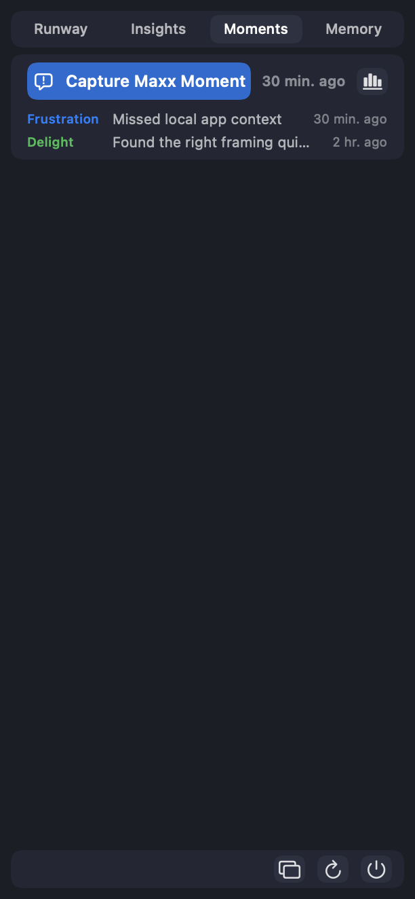
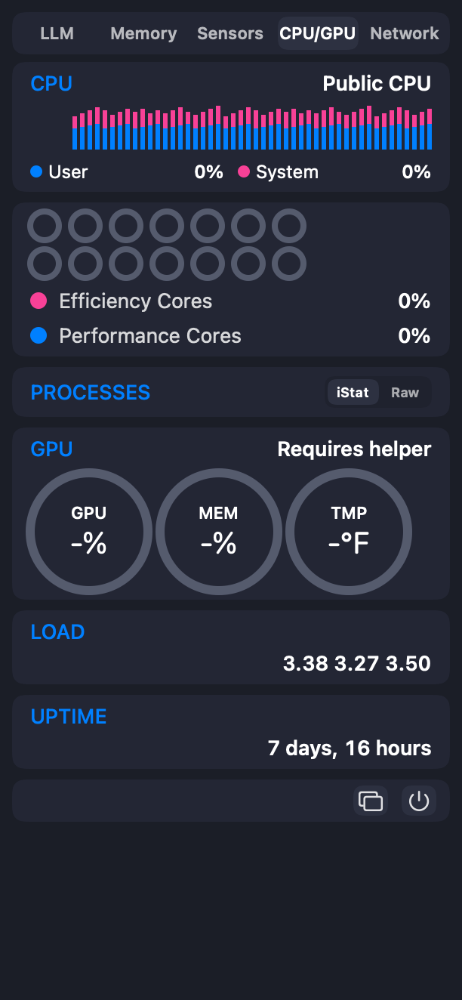

# MaxxBar

A macOS menu bar companion for AI runway and local AI usage insight. MaxxBar keeps the useful Codex quota, token, memory, and machine-load foundations from Menu Bar Stats, then makes the main product about how much AI runway is left, what local sessions are driving it, and what work tends to happen before and after AI use.

## Screenshots

### Runway


The Runway panel shows live Codex 5H and weekly limits, reset credits when the
usage API reports them, local token estimates, persisted drawdown, and recent
session timelines. Sparse drawdown history zooms to the samples MaxxBar has
instead of leaving most of the chart empty.

### Insights


The Insights panel shows local AI session patterns, before/after context,
TraceWork-inspired workflow paths, and recent Codex session timelines.

### Moments



The Moments panel captures frustration or delight moments with an optional local
screenshot and note, plus recent local Maxx Moment history.

### Memory


### Advanced Machine Context



CPU/GPU information remains available in the codebase as advanced machine-load
context, but the default popover is focused on Runway, Insights, Moments, and
Memory.

## Current Features

- Two-line menu bar status for AI runway, weekly reset day, and meaningful AI insight events captured today.
- Runway-first popover with Codex limits, reset credits, persistent local quota history, drawdown milestones, cache-token detail, token/session totals, and recent local session timelines.
- Local AI activity logging for app/site metadata, AI surface detection, session duration estimates, before/after workflow paths, and nearby system-load context.
- Maxx Moment capture for saving frustration or delight, optional local screenshot, current app/site, detected AI surface, quota/system state, and a user note.
- Local HTML AI insights report with top tools, likely use cases, before/after apps, workflow paths, and a Sankey-style path visual.
- Separate MaxxBar Hub with Tracework-aligned visual language and full Overview, AI Insights, Runway, Sessions, and Advanced destinations. The Hub is a superset of the dropdown, including live limits, drawdown history, session timeline, expandable session diagnostics, local usage windows, cost estimates, daily/weekly patterns, and confirmed AI output destinations.
- Metadata-only Cmd+C/Cmd+V flow tracking that records source and destination context without reading or storing clipboard contents or typed text.
- Start Deep Trace handoff that opens the Tracework Hub on demand while MaxxBar remains the always-on app.
- Memory popover with pressure, memory breakdown, top processes, swap, and lighter-weight numeric values for scanability.
- Grouped and raw process memory views with app icons.
- CPU/GPU panel code with user/system history, per-core efficiency/performance load rings, grouped CPU processes, thermal summary, detailed temperatures, and uptime for advanced/debug builds.
- Pop-out window mode with resize support and quit control.

## Known Limits

Some low-level hardware data requires privileged or private telemetry that this app does not currently collect directly:

- CPU/GPU die temperatures.
- Fan RPM and fan controller state.
- GPU usage, GPU memory, FPS, and GPU frequency.
- SSD, Wi-Fi, palm-rest, airflow, and other detailed thermal sensors.
- Per-process network attribution.

The app marks unavailable values clearly rather than inventing data. A native helper target is included for privileged sensor collection work.

## Build

```sh
swift build
```

## Build The App Bundle

```sh
Scripts/build-app.sh
```

The app bundle is written to `Dist/MaxxBar.app`. The renderer used for the
README screenshots can write any panel to a PNG:

```sh
.build/debug/MaxxBar --render-popover Artifacts/screenshot-llm.png runway
.build/debug/MaxxBar --render-popover Artifacts/screenshot-insights.png insights
.build/debug/MaxxBar --render-popover Artifacts/screenshot-moments.png moments
.build/debug/MaxxBar --render-popover Artifacts/screenshot-memory.png memory
.build/debug/MaxxBar --render-popover Artifacts/screenshot-cpugpu.png cpugpu
```

## Install On This Mac

```sh
Scripts/install-app.sh
```

The install script builds a fresh local app bundle, copies it to
`~/Applications/MaxxBar.app`, signs it ad hoc, and recreates the Desktop
shortcut so it points at the local install instead of an iCloud-hosted build
artifact from another laptop.

## Sensor Helper

Build and install the privileged helper:

```sh
Scripts/install-sensor-helper.sh
```

The helper runs as `com.hector.MaxxBarSensorHelper` and writes a local snapshot to:

```text
/Library/Application Support/MaxxBar/sensors.json
```

Remove it with:

```sh
Scripts/uninstall-sensor-helper.sh
```

## Useful Verification Commands

```sh
swift run MaxxBar -- --sample
swift run MaxxBar -- --render-popover Artifacts/screenshot-llm.png runway
swift run MaxxBar -- --render-popover Artifacts/screenshot-insights.png insights
swift run MaxxBar -- --render-popover Artifacts/screenshot-moments.png moments
swift run MaxxBar -- --write-ai-report
Dist/MaxxBar.app/Contents/MacOS/MaxxBar --verify-popover-action
Dist/MaxxBar.app/Contents/MacOS/MaxxBar --verify-popout-action
```

## Data Notes

See `Docs/data-audit.md` for implementation notes about source paths, validation, and remaining telemetry gaps.

LLM quota history is stored in:

```text
~/Library/Application Support/MaxxBar/llm-quota-history.json
```

AI activity metadata is stored locally in:

```text
~/Library/Application Support/MaxxBar/ai-activity.jsonl
~/Library/Application Support/MaxxBar/ai-transfers.jsonl
~/Library/Application Support/MaxxBar/maxx-moments.jsonl
~/Library/Application Support/MaxxBar/maxx-moment-screenshots/
~/Library/Application Support/MaxxBar/maxxbar-hub.html
```

The AI logs are local-only metadata. Copy/paste events include app/site/title
context and a static `no_clipboard_content` privacy marker, never clipboard
contents. Screenshots are stored only when included in a Maxx Moment. MaxxBar
does not store OCR output, typed text, or cloud uploads.

Each sample records the sampled time, 5H remaining percentage, weekly remaining
percentage, and current plan type when the Codex usage API reports one. The LLM
panel derives the most recent drawdown timeline from these samples, including
the last full point, threshold crossings, exhaustion, reset, elapsed time, and
the plan logged for that run. Exact crossing times are bounded by the sampling
interval.
