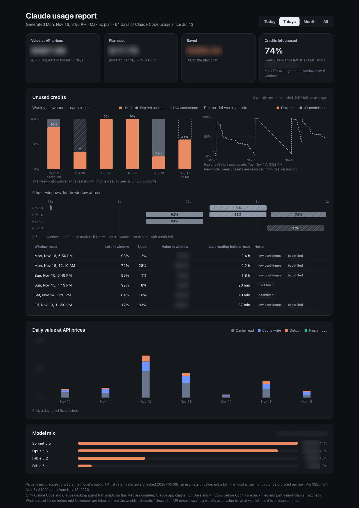

# MaxxBar

MaxxBar is a macOS menu bar app that tells you how much Claude and Codex runway you have left, when you will run out, and what your usage is worth.

Current release: `v0.3.0`. See [RELEASE_NOTES.md](RELEASE_NOTES.md) for what changed.

## Screenshots

<p>
  
  
  
  
</p>

The full page usage report (dollar amounts blurred):



The popover screenshots use built-in demo data.

## What It Does

- **Runway at a glance.** 5 hour and weekly percent left in the menu bar, with time until reset.
- **Early warning.** The column turns amber and shows `out 48m` or `Thu 2p` when you are on pace to run out before the reset.
- **One provider or both.** Track Claude, Codex, or both from the eye menu. A hidden provider costs nothing: it is not polled or scanned.
- **Burn rate that survives plan changes.** The drawdown card shows your pace since the last reset or plan upgrade.
- **What you left on the table.** Left at reset records how much of each 5 hour and weekly window expired unused.
- **What you are about to leave.** Waste forecast predicts how much of this week's allowance will expire at your usual pace, and how much more to spend to finish near 90%.
- **What it is worth.** API Value prices your usage at API list rates for today, this week, 7 days and the month, next to your plan price.
- **Full usage report.** One offline page with value, plan cost, unused allowance, 5 hour windows, daily sessions and model mix.
- **Local model monitor.** The CPU/GPU tab shows throttling, temperatures, fans, power, GPU load and the busiest processes.
- **Memory too.** Pressure, memory mix, top apps, swap and sensors.
- **Feeds other apps.** Writes `usage-feed.json` for tools like Tracework ([Docs/usage-feed.md](Docs/usage-feed.md)).
- **Light on battery.** Pauses when the Mac is locked or asleep, refreshes once a minute in the background, opens at login.
- **Stays on your Mac.** Only the usage checks go to Anthropic and OpenAI. Clipboard text and sign-in tokens are never stored.

## Popover Tabs

- **Runway:** live limits and resets, weekly drawdown, your pace, waste forecast, left at reset, session timeline.
- **Insights:** API Value, accounts and plans, model mix, output destinations, workflow paths.
- **Memory:** pressure, memory mix, top apps, swap, sensors.
- **CPU/GPU:** thermal state, power, temperatures, fans, CPU and GPU load, top processes.

Drag the lower-right grip to resize the popover; the size is remembered. The bottom bar opens the MaxxBar Hub, starts Deep Trace in Tracework, pops the popover out as a window, relaunches, or quits.

## Tracking Claude Or Codex

Use the eye menu in the popover to show or hide each provider. You can hide one but not both. Hiding a provider stops everything MaxxBar does for it: no usage request, no Keychain or token read, and no transcript or sqlite scan. Showing it again refreshes right away.

Quota history (`llm-quota-history.json`) records, for each sample, the Claude and Codex 5h and weekly percent left, each window's reset time, the plan for each provider, and where the Claude reading came from (`statusline`, `endpoint`, or `cache`). The Claude plan comes from the rate limit tier in `~/.claude.json`, for example `Max 5x`. A plan change rescales every percentage (the same usage is a smaller share of a bigger allowance), so the drawdown insight starts a new segment at a plan change instead of reading it as a reset, and its pace line only uses samples taken since the last reset or plan change. Files written by older builds still load; their samples simply lack the newer fields.

## Energy

MaxxBar stops sampling and polling while the screen is locked, the display is asleep, or the Mac is asleep, and refreshes once when you return. Lock screen samples are not written to the activity log. While the popover is closed only the quotas refresh. The Claude credential is reused until its own expiry instead of being read from the Keychain on every refresh, transcripts older than 8 days are skipped, a growing transcript is parsed from where the last pass stopped, and the activity logs are read from the end back to the 7 day cutoff. Parsed transcript totals are saved to `claude-parse-cache.json`, so a launch only reads what was appended since the last run. The refresh timer runs once a minute while the popover is closed.

Once a day, lines older than 30 days move from `ai-activity.jsonl`, `ai-transfers.jsonl`, `clipboard-metadata.jsonl`, and `llm-5h-usage-windows.jsonl` into an `archive` folder next to them. Nothing is deleted; remove the archive folder by hand if you do not need it.

## Build

```sh
swift build
```

## Build The App Bundle

```sh
Scripts/build-app.sh
```

The app bundle is written to `Dist.noindex/MaxxBar.app` by default. Set `APP_VERSION` or `BUILD_VERSION` to override bundle metadata:

```sh
APP_VERSION=0.3.0 BUILD_VERSION=1116.1200 Scripts/build-app.sh
```

## Install On This Mac

```sh
Scripts/install-app.sh
```

The install script builds a fresh release (optimized) app bundle, copies it to `~/Applications/MaxxBar.app`, signs it ad hoc, and recreates the Desktop shortcut so it points at the local install instead of an iCloud-hosted build artifact from another laptop.

## Useful Verification Commands

```sh
swift run MaxxBar -- --sample
swift run MaxxBar -- --render-popover Artifacts/screenshot-llm.png runway
swift run MaxxBar -- --render-popover Artifacts/screenshot-insights.png insights
swift run MaxxBar -- --render-popover Artifacts/screenshot-memory.png memory
swift run MaxxBar -- --render-popover Artifacts/screenshot-cpugpu.png cpu
swift run MaxxBar -- --write-ai-report
swift run MaxxBar -- --write-usage-report
Dist.noindex/MaxxBar.app/Contents/MacOS/MaxxBar --verify-popover-action
Dist.noindex/MaxxBar.app/Contents/MacOS/MaxxBar --verify-popout-action
```

## Tests

The tests are small programs compiled with `swiftc`:

```sh
Scripts/test-claude-polling.sh
Scripts/test-quota-estimator.sh
Scripts/test-api-pricing.sh
Scripts/test-claude-credentials.sh
Scripts/test-usage-feed.sh
Scripts/test-runway-forecast.sh
Scripts/test-log-retention.sh
Scripts/test-quota-ledger.sh
Scripts/test-waste-forecast.sh
```

The project lives in iCloud Drive, so `.build` is a symbolic link to `~/Library/Developer/MaxxBar-build/.build` and build products are not synced. On a new Mac, recreate it with `mkdir -p ~/Library/Developer/MaxxBar-build/.build && ln -s ~/Library/Developer/MaxxBar-build/.build .build`.

On a Mac where the default SDK does not match the toolchain, prefix commands with `SDKROOT=/Library/Developer/CommandLineTools/SDKs/MacOSX26.5.sdk`.

## Data And Privacy

See `Docs/data-audit.md` for implementation notes about source paths, validation, and remaining telemetry gaps.

### Codex Authentication And Live Usage

To show live Codex quota and reset information, MaxxBar reads the existing Codex access token from `~/.codex/auth.json` and sends it as a bearer token only to `https://chatgpt.com/backend-api/wham/usage`. MaxxBar does not copy the token into its own data files, include it in reports, or send it to any other service.

This ChatGPT usage endpoint is undocumented and is not a stable, officially supported public API. It may change or stop working without notice. MaxxBar is an independent project and is not affiliated with or endorsed by OpenAI. Users should install and run MaxxBar only if they are comfortable allowing a local application to read their existing Codex credential for this request. If the credential or endpoint is unavailable, live quota information is disabled while locally derived session and token information may remain available.

### Claude Sessions And Live Usage

MaxxBar discovers local Claude Code and Claude Desktop/Cowork transcripts under `~/.claude/projects` and Claude's local-agent session directory. It reads session metadata and the token-usage fields Claude already stores locally: provider, title, project, model, timestamps, input, cache creation/read, and output totals. Prompt previews are limited to the locally stored first user message; MaxxBar does not upload transcript content.

The Insights account label comes from Claude’s local `~/.claude.json` profile metadata (email, display name, organization, and rate limit or seat tier). The file is parsed once per change. Codex account email and plan come from the live usage response described above. These labels remain inside MaxxBar’s local UI and reports.

For live five-hour and weekly Claude runway, MaxxBar uses the existing Claude Code OAuth credential from `~/.claude/.credentials.json` or the `Claude Code-credentials` macOS Keychain item and sends it only to `https://api.anthropic.com/api/oauth/usage`. The token is not copied into MaxxBar data or reports. It is kept in memory until its own expiry, or until Claude rejects it, so the Keychain is not read on every refresh. This endpoint is used by Claude Code but is not a stable public API. Claude Desktop/Cowork authentication alone may not expose a Claude Code OAuth credential; in that state MaxxBar still captures local Claude sessions and shows a provider-status note until Claude Code is signed in.

Claude Code keep-alive: when Claude Code's stored access token has expired (or Claude rejects it), MaxxBar runs one tiny `claude -p "ok" --model haiku` request from an empty temporary folder, with no tools, MCP servers, slash commands, settings or saved session, and a 60-second limit. Claude Code refreshes and saves its own sign-in as part of that request; MaxxBar never writes the Keychain and never runs `claude auth login`. MaxxBar then checks that the Keychain holds a complete credential with a later expiry and reads usage right away. A failed attempt is retried once after 10 minutes; after that the card says to open `claude` or run `claude auth login`, and nothing runs again until the credential changes. Cost: one Haiku request roughly every 8 hours. Turn it off with `defaults write com.hector.MaxxBar ClaudeKeepAlive -bool false`. Each attempt is logged (times, exit code, expiry times; never tokens or CLI output) to `~/Library/Application Support/MaxxBar/claude-keepalive.log`. Without a usable token, MaxxBar keeps showing the last usage it read, marked with its check time, until those windows reset.

For live Claude runway without extra network requests, run `Scripts/install-claude-statusline-tap.sh` once. It points Claude Code's status line at a small tap that saves the `rate_limits` Claude Code already receives (5h and weekly usage) to `~/Library/Application Support/MaxxBar/claude-statusline.json`, then runs your previous status line command so its output is unchanged. MaxxBar prefers a capture from the last 30 minutes; while one exists it asks the usage endpoint at most hourly, only for the Opus and Sonnet weekly windows. Undo with `Scripts/install-claude-statusline-tap.sh --uninstall`.

Otherwise, Claude usage refreshes from the endpoint every 3 minutes while Claude is in use, every 5 minutes normally, and every 30 minutes when idle. It also asks at the moments a reading is worth most: when the popover opens on a reading over 2 minutes old, after a reset time in the last reading passes, when the Mac wakes or unlocks, and when local token use since the last reading is estimated to have moved the 5 hour window by 5 points. Every request, whatever asked for it and including Check now, passes the same gate: the 429 cooldown, at least 60 seconds since the last request, and at most 30 requests in any hour (the old 2 minute schedule's rate, now a ceiling). HTTP 429 responses trigger an increasing cooldown (five minutes to one hour), honoring longer `Retry-After` delays. The last successful usage response and cooldown are saved locally across restarts, with the Claude account ID (or a credential fingerprint) but no OAuth token. The cooldown survives Claude Code's token refreshes. Cached readings show their check time; windows whose reset has passed are omitted, and readings older than 24 hours are discarded.

Other apps can read a small, versioned summary of quota and token use from `usage-feed.json`; its fields are documented in [Docs/usage-feed.md](Docs/usage-feed.md). Each quota window says whether its numbers are `measured` (a real reading) or `estimated` (the last reading plus local tokens since), and an estimated window also carries the real reading it builds on (`measuredRemainingPercent`, `measuredUsedPercent`); `checkedAt` stays the real reading's time. These fields were added without a version change, so a reader that ignores them sees the same numbers MaxxBar shows.

Between readings MaxxBar estimates Claude 5h and weekly usage from the tokens it already counts in local transcripts. It calibrates tokens per percent from consecutive pairs of real readings inside the same window, taken on the current plan and since the current weekly window began, pooling every pair so the whole-percent rounding of each reading evens out. It tries raw tokens and tokens weighted by each model's API prices and uses whichever fits the readings more closely. With fewer than 3 pairs in which the reading moved (or under 3 points moved in total) there is no estimate. Each new reading replaces the estimate; an estimate never goes below 0, above 100, or down between two readings, and stops at the window's reset. Estimates show with "~" in the menu bar and on the Runway bars, the card says where the reading came from and how old it is, and the time until empty uses the estimate so it moves smoothly. Estimates are never saved as readings: `llm-quota-history.json`, the window ledger and the activity log only hold real ones. The real readings it calibrates from are kept for 8 days in `claude-readings.json`. Usage on claude.ai or another Mac is not in the local transcripts, so the estimate can only lag the truth; the next reading catches it up.

When a Claude quota window resets (the 5 hour window, the weekly window, and per-model weeklies such as Fable), MaxxBar records what was left unused in `llm-window-ledger.jsonl`, one line per closed window, append only and never trimmed. The first run backfills from the saved quota history. A reading taken more than 30 minutes before the reset is marked low confidence, and MaxxBar takes a fresh reading two minutes before each known reset. The Runway tab's Left at reset card summarizes it, and Open full report writes `report/usage-report.html` (one self-contained page, no network requests) with value at API prices, plan cost, unused weekly allowance, 5 hour windows, daily sessions and model mix.

API Value prices each Claude request in the local transcripts at its model's API list rate (input, output, cache reads, and 5 minute and 1 hour cache writes; the price table records the date it was checked). Daily totals are kept in `api-cost-ledger.json`, backfilled once from every transcript on disk, so "this month" covers days the live 8 day scan no longer reads. It is an estimate of value, not a bill. Codex is not priced yet. The table (`LLMTokenPricing` in `LLMUsageTypes.swift`) stores each model's input, 5 minute and 1 hour cache write, cache read and output rates, matches the longest model ID prefix (so `claude-fable-5-2[1m]` finds Fable 5.2, not Fable 5), and prices Haiku 5.5 (over 100K prompt tokens) and gpt-5.6 / gpt-5.5 (over 272K input tokens) per request by prompt size. When the table's date changes, the next launch reprices every transcript still on disk into the ledger; days whose transcripts are gone keep their old totals.

Local files are stored under:

```text
~/Library/Application Support/MaxxBar/claude-auth-retry.json
~/Library/Application Support/MaxxBar/claude-usage-cache.json
~/Library/Application Support/MaxxBar/claude-readings.json
~/Library/Application Support/MaxxBar/llm-quota-history.json
~/Library/Application Support/MaxxBar/usage-feed.json
~/Library/Application Support/MaxxBar/ai-activity.jsonl
~/Library/Application Support/MaxxBar/ai-transfers.jsonl
~/Library/Application Support/MaxxBar/llm-5h-usage-windows.jsonl
~/Library/Application Support/MaxxBar/api-cost-ledger.json
~/Library/Application Support/MaxxBar/llm-window-ledger.jsonl
~/Library/Application Support/MaxxBar/report/usage-report.html
~/Library/Application Support/MaxxBar/claude-parse-cache.json
~/Library/Application Support/MaxxBar/archive/
~/Library/Application Support/MaxxBar/maxxbar-hub.html
```

The AI activity and copy/paste transfer logs are local-only metadata. Copies and pastes are recorded from Cmd+C and Cmd+V only; there is no pasteboard poller, and MaxxBar never reads or stores clipboard contents, including images. The 5h usage log appends a line only when the window's numbers change.

Paste attempts currently mean observed Cmd+V. macOS does not provide a general notification when another app reads the pasteboard, so right-click and menu-driven pastes cannot always be counted or attributed. A displayed output flow requires an observed clipboard write followed by a paste within 15 minutes; Claude-to-Claude and Codex-to-Codex pairs are excluded while Claude↔Codex and AI-to-other-app flows remain. MaxxBar does not store clipboard contents, OCR output, typed text, or cloud uploads.

## Known Limits

CPU/GPU temperatures and fan RPM are read locally through a read-only AppleSMC connection when available, with the existing native-helper cache and public battery telemetry as additional sources. Direct CPU temperature reports the warmest supported CPU sensor. Temperature labels respect the existing temperature-unit preference. Sensor keys vary by Mac; unavailable readings display a dash. GPU frequency and SSD thermals remain limited. A native helper target remains available for privileged sensor collection work.
