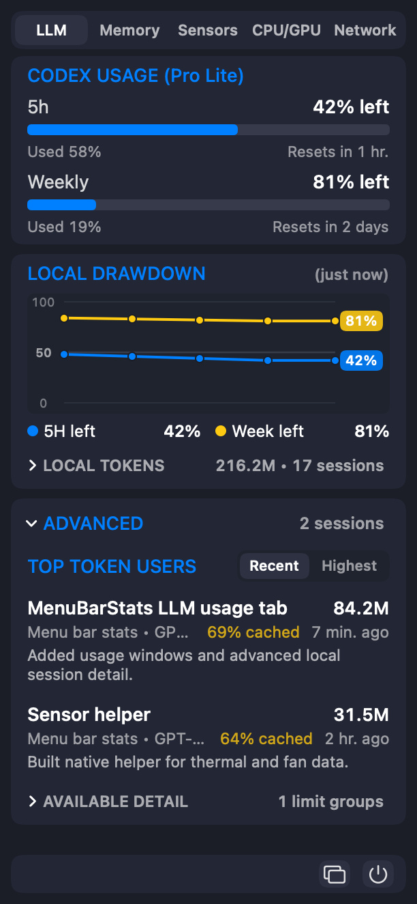
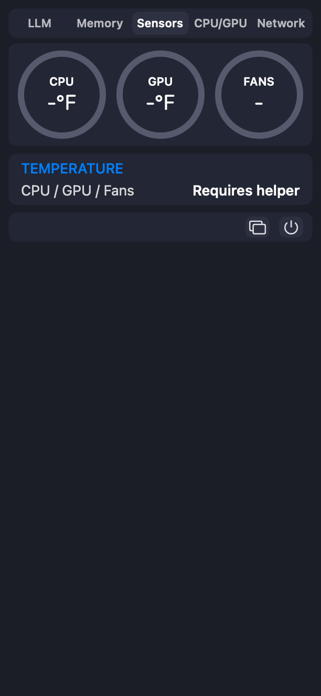
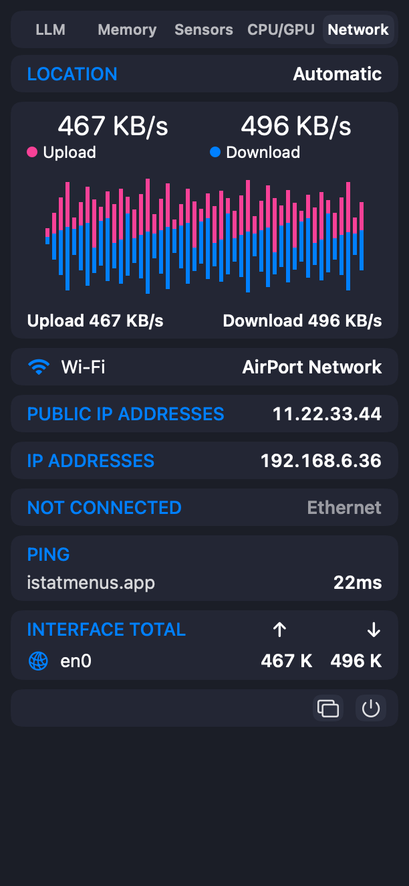

# MenuBarStats

A macOS menu bar system monitor with a compact menu bar readout and popover panels for LLM usage, memory, sensors, CPU/GPU, and network activity.

## Screenshots

### LLM Usage



### Memory


### Sensors



### CPU/GPU


### Network



## Current Features

- Two-line menu bar status for Codex usage and memory pressure.
- LLM usage panel with Codex limits, persistent local quota history, cache-token detail, token/session totals, top token users, and context actions for local Codex sessions.
- Memory popover with pressure, memory breakdown, top processes, paging, swap, and history.
- Grouped and raw process memory views with app icons.
- CPU/GPU panel with user/system history, per-core efficiency/performance load rings, grouped CPU processes, load averages, and uptime.
- Sensors panel with battery/system input telemetry and native helper cache support.
- Network panel with interface throughput, IP address, and traffic history.
- Pop-out window mode with resize support and quit control.

## Known Limits

Some low-level hardware data requires privileged or private telemetry that this app does not currently collect directly:

- CPU/GPU die temperatures.
- Fan RPM and fan controller state.
- GPU usage, GPU memory, FPS, and GPU frequency.
- SSD, Wi-Fi, palm-rest, airflow, and other detailed thermal sensors.
- Per-process network attribution.

The app marks unavailable values clearly rather than inventing data. A native helper target is included for privileged sensor collection work.

## Build

```sh
swift build
```

## Build The App Bundle

```sh
Scripts/build-app.sh
```

The app bundle is written to `Dist/MenuBarStats.app`.

## Sensor Helper

Build and install the privileged helper:

```sh
Scripts/install-sensor-helper.sh
```

The helper runs as `com.hector.MenuBarStatsSensorHelper` and writes a local snapshot to:

```text
/Library/Application Support/MenuBarStats/sensors.json
```

Remove it with:

```sh
Scripts/uninstall-sensor-helper.sh
```

## Useful Verification Commands

```sh
swift run MenuBarStats -- --sample
swift run MenuBarStats -- --render-popover Artifacts/popover-demo.png
Dist/MenuBarStats.app/Contents/MacOS/MenuBarStats --verify-popover-action
Dist/MenuBarStats.app/Contents/MacOS/MenuBarStats --verify-popout-action
```

## Data Notes

See `Docs/data-audit.md` for implementation notes about source paths, validation, and remaining telemetry gaps.
